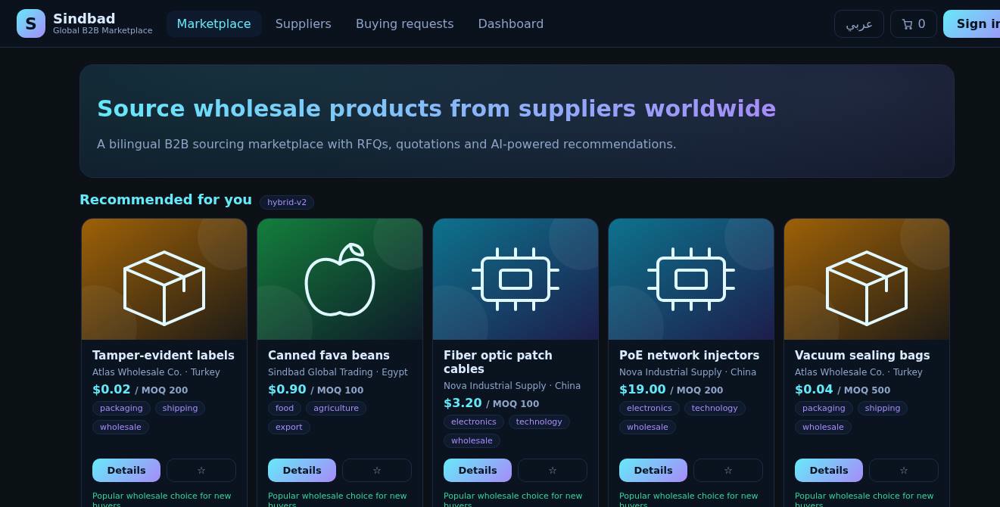

<picture></picture>

<p align="center"><strong>A local development build of a bilingual (Arabic/English) B2B sourcing marketplace.</strong></p>

<p align="center">


</p>

<sub>Artwork is illustrative.</sub>



## Run on Windows

1. Install Python 3.10+ (Python 3.13 is supported).
2. Extract this folder.
3. Double-click `START.bat` and keep the terminal open.
4. Your browser should open automatically. If it does not, visit http://127.0.0.1:8000

## Run on macOS or Linux

```bash
python3 -m venv venv && source venv/bin/activate
pip install -r requirements.txt
uvicorn main:app --port 8000
```

Then open http://127.0.0.1:8000. The SQLite database (`sindbad.db`) is created and seeded on first start.

## Tests

```bash
pip install -r requirements-dev.txt
pytest
```

The tests use a temporary database and cover login, registration, role checks, product ownership, MOQ and stock rules for orders, the RFQ and quotation flow, and the recommendation response.

## Demo accounts

| Role | Email | Password |
|---|---|---|
| Supplier | `demo@sindbad.com` | `demo1234` |
| Buyer | `buyer@sindbad.com` | `buyer1234` |
| More suppliers | `atlas@sindbad.com`, `nova@sindbad.com` | `demo1234` |

## Included implementation

- Buyer/supplier registration, login and role checks.
- Product catalog with 120 seeded wholesale listings, search, category/origin/price filters and sorting.
- Supplier catalog publishing and product ownership checks.
- Product details, favorites, sourcing cart and demo order checkout (no payment is collected).
- RFQ publishing, supplier quotations, buyer quote comparison, and buyer RFQ/order dashboard.
- Supplier directory, supplier-side product management, open buying requests, and business statistics.
- Hybrid recommendation endpoint: category and tag affinity, weighted user-user collaborative filtering, popularity prior and cold-start fallback.
- Arabic/English UI with RTL/LTR switching.

## Recommendation system

`GET /api/recommendations` returns ranked products with a score and a reason. It uses a transparent hybrid baseline combining content/category affinity and collaborative-style aggregate popularity signals. It is an implementation-ready baseline, not a trained deep-learning model. For a research-grade model, collect a larger consented interaction dataset, add offline train/validation splits, compare content-based, item-item collaborative and hybrid models, and report Precision@K, Recall@K and NDCG@K.

The response envelope includes `items`, `strategy`, `model`, and `personalized`, and the frontend consumes this format. Product detail views, add-to-cart events and favorites feed interaction signals, and the recommendation cards explain why an item was suggested.

Test endpoints: `GET /api/health`, `GET /api/products?limit=200`, `GET /api/recommendations?limit=12`.

## Main API routes

- `POST /api/register`, `POST /api/login`, `GET /api/me`, `POST /api/logout`
- `GET /api/products`, `GET /api/products/{id}`, `POST/PUT/DELETE /api/products`
- `GET /api/categories`, `GET /api/suppliers`
- `POST /api/interactions`, `GET /api/recommendations`
- `GET/POST /api/favorites`, `POST /api/favorites/{product_id}`
- `POST /api/orders`, `GET /api/orders`
- `POST /api/rfqs`, `GET /api/rfqs`, `POST/GET /api/rfqs/{id}/quotes`, `GET /api/dashboard`, `GET /api/supplier/products`

## Catalogue data

The demo catalogue holds **120 wholesale listings** across 8 B2B categories and 3 demo supplier companies. Product pictures are AI-generated studio-style images (see Product photos below) or local category illustrations (`static/art/`), so the app works offline. Listings are clearly sample marketplace data and should be replaced/verified before public launch. Existing `sindbad.db` files are upgraded additively: missing sample products are inserted by title; user accounts, orders, RFQs and existing interactions are not deleted.

## Important deployment note

This is a local MVP/dev build. Before public production deployment, configure a strong `SINDBAD_SECRET`, HTTPS, PostgreSQL, migrations, rate limiting, CSRF protection, audit logs, backups, supplier verification, and real payment/shipping integrations. Demo checkout does not charge money.

## Product photos

Product photos in `photos/*.txt` are AI-generated studio-style images (one per product, checked by eye against the product title). They are stored as base64 text in the repo and served from `/photo/<id>.jpg`. Products without a photo yet use the category illustration in `static/art/`. No third-party or scraped images are used.

## Recommendation system ("You may also like")

Two places use the model. (1) **"Recommended for you"** on the home page: a signed-in buyer with activity gets a personal ranking. Their own events (view, cart, favourite, purchase) are weighted, each candidate product is scored by its blended similarity to the products they touched, items they already touched are removed, and the reason names the product that contributed most. Anonymous visitors and buyers with no history get a popularity fallback, limited to 2 per category, labelled as demo interaction data. The row is recomputed on every request, and the model refits when the number of real interactions changes. (2) **"You may also like"** in the product popup is item-to-item: the same list for everyone viewing that product.

Open any product to see six recommended products with the reason for each. The model lives in `recommender.py` (numpy only). Endpoints: `GET /api/products/{id}/similar` and `GET /api/ml/info`.

**How it works.** Three models are fitted at startup and blended:

1. **Content (TF-IDF).** Each product becomes a TF-IDF vector over its title, category and tags (words and word pairs, light stemming). Cosine similarity between vectors finds products with similar text. It needs no buyer data, so it works for brand-new products.
2. **Item-item collaborative filtering.** Buyers x products matrix, with events weighted (view 1, click 1.7, cart 3.5, favourite 4, purchase 5) and smoothed with log(1+x). Products are compared by cosine similarity of their buyer columns, so products bought by the same people score high even when their text is unrelated (for example helmets and water pumps).
3. **SVD.** A truncated SVD (16 factors) of the same matrix gives latent product factors, again compared by cosine similarity. It can connect products that never share a buyer directly.

The final score is a weighted sum of the three per-product scores, each min-max scaled. The reason chips in the UI show how much came from collaborative signals ("bought together") and from text.

**Data. This matters.** The marketplace has almost no real traffic, so the collaborative models are trained on **synthetic but labelled** interactions: `scripts/make_synthetic.py` plants 8 buyer segments (hotel procurement, construction site, office IT, food importer, retail, outdoor sports, healthcare cleaning, factory maintenance) with cross-category buying patterns, 15% random noise and event chains (view, click, cart, purchase). The file is `data/synthetic_interactions.txt` (8405 rows, 480 buyers). Real interactions from the `interactions` table are added automatically and the model refits when they change.

**Evaluation** (`python scripts/evaluate.py`, results in `docs/evaluation.json`). Leave-one-out: one interacted product per buyer is hidden, the models rank the products the buyer has not touched, and we check whether the hidden one is in the top 10. Buyers are split in two halves: blend weights are chosen on one half, the numbers below come from the other half. Mean of 5 random splits. Scenarios with less data keep a random 25% or 10% of training rows to mimic a young marketplace.

HitRate@10 (mean over 5 splits, std in brackets; 10 of 120 products is about 0.08 by chance):

| Model | All data (7447 rows) | 25% of data (1880 rows) | 10% of data (840 rows) |
|---|---|---|---|
| Random | 0.087 (±0.013) | 0.065 (±0.009) | 0.077 (±0.017) |
| Popularity | 0.205 (±0.032) | 0.174 (±0.031) | 0.166 (±0.019) |
| Content (TF-IDF) | 0.454 (±0.026) | 0.314 (±0.016) | 0.272 (±0.019) |
| Item-item CF | 0.758 (±0.012) | 0.486 (±0.029) | 0.302 (±0.018) |
| SVD (matrix factorisation) | 0.636 (±0.021) | 0.433 (±0.031) | 0.280 (±0.018) |
| Hybrid (blend) | 0.758 (±0.012) | 0.496 (±0.032) | 0.336 (±0.021) |

NDCG@10:

| Model | All data (7447 rows) | 25% of data (1880 rows) | 10% of data (840 rows) |
|---|---|---|---|
| Random | 0.044 | 0.030 | 0.035 |
| Popularity | 0.121 | 0.097 | 0.090 |
| Content (TF-IDF) | 0.208 | 0.147 | 0.128 |
| Item-item CF | 0.458 | 0.240 | 0.148 |
| SVD (matrix factorisation) | 0.331 | 0.206 | 0.141 |
| Hybrid (blend) | 0.458 | 0.241 | 0.162 |

Blend weights picked on validation data (mean over splits):
- All data (7447 rows): content 0.00, item-kNN 1.00, SVD 0.00
- 25% of data (1880 rows): content 0.15, item-kNN 0.85, SVD 0.00
- 10% of data (840 rows): content 0.25, item-kNN 0.60, SVD 0.15

**What the numbers show, and what they do not.**
- Collaborative filtering clearly beats text-only and popularity on this data, because the planted segments cross categories and text similarity cannot see that.
- With less data every model drops and the gap to the content model closes. The hybrid is ahead of item-item CF only when data is very thin (10%: 0.336 vs 0.302, about 1.5 standard deviations). At 25% the difference is within noise. With full data the validation search puts all weight on item-item CF, so the hybrid equals it. So the blend helps mainly in the cold-start regime, and I do not claim more than that.
- The segments are my own construction, so these numbers show that the models can **recover planted structure**. They do **not** predict performance on real buyers. Real evaluation needs real traffic, which is why live interactions feed the model.
- No online (click-through) test has been run. Product text is short, so the content model is coarse.

Tests: `tests/test_recommender.py` (tokenizer, TF-IDF, each model on tiny hand-made cases, an evaluation check that the hybrid beats popularity) and an API test for `/similar`.

## Database (persistent PostgreSQL, SQLite fallback)

The app picks its database from one environment variable:

- `DATABASE_URL` set (a `postgresql://...` URL): PostgreSQL. The live demo uses a free Neon Postgres project (no card needed), so accounts, favourites, RFQs and recommender events survive restarts and redeploys.
- not set: a local `sindbad.db` SQLite file, as before. Nothing to install or configure.

`dbcompat.py` is a small adapter so one set of SQL runs on both. The tests run on both (`DATABASE_URL=... pytest`, each test in its own schema).

Schema: `users`, `roles`, `user_roles` (admin is a role), `suppliers`, `products`, `interactions` (real events), `event_types` (event weights), `synthetic_interactions` (labelled synthetic buyers, `is_synthetic = 1`, seeded from `data/synthetic_interactions.txt`), `favorites`, `orders`/RFQs, and `resources` (a registry of the tables and datasets, with a synthetic flag). `GET /api/resources` lists them with row counts and the active backend.

There are no default admin credentials. To make an existing account an admin: `python scripts/make_admin.py you@example.com`.
